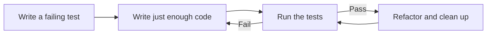

# Module 10: Testing, Code Quality and Best Practices

### Why does this module matter?
Code that runs once on your laptop is not enough. In a real job, your code must keep working after every change, be understood by teammates, and be easy to fix when something breaks. This module teaches you how to **test** your code automatically, write it in a **clean and readable** way, and use **Pythonic** habits that experienced developers follow.

Real-life comparison: an **aircraft pre-flight checklist**. Pilots don't rely on memory. Each item is checked every time, so problems are caught before the plane takes off. Automated tests are your code's checklist.

---

## 1. Unit Testing Concepts 

### What is a unit test?
A **unit test** checks **one small piece** of code (a **unit**), usually one function or method, on its own. You give it a known input, and check that the output is what you expected.

Real-life example: testing a **single bulb** before fitting it into the house. You don't wire the whole house to check one bulb. You connect the bulb to a battery and see whether it lights up.

```python
def add(a, b):
    return a + b

# manual check
print(add(2, 3))     # 5  → looks right, but a human must read it every time
```
A unit test replaces that manual reading with an **automatic check**:
```python
assert add(2, 3) == 5    # fails loudly if the function ever breaks
```

### Why automated tests matter
- They run in **seconds**, every time you change the code.
- They catch **regressions**, meaning old features that break after a new change.
- They act as **documentation**: a test shows how a function is meant to be used.
- They give you the **confidence to change code** and improve it.

### The three parts of a test: Arrange, Act, Assert
Every good test follows three steps, often called **AAA**:
1. **Arrange**: prepare the inputs and objects
2. **Act**: call the function being tested
3. **Assert**: check that the result is correct

```python
def test_add_two_positive_numbers():
    # Arrange
    a, b = 2, 3
    # Act
    result = add(a, b)
    # Assert
    assert result == 5
```

### Good unit test qualities (remember FIRST)
- **Fast**: runs in milliseconds
- **Independent**: one test does not depend on another
- **Repeatable**: same result every time
- **Self-checking**: passes or fails by itself, with no human reading output
- **Timely**: written close to the time the code is written

### Test cases to think about
A good test set covers:
- the **normal** case (2 + 3 = 5)
- **edge** cases (0, negative numbers, very large numbers, empty input)
- **error** cases (wrong types, invalid input)

### The testing cycle

This loop is called **red, green, refactor**: the test fails (red), you make it pass (green), then you improve the code (refactor).

### Real-time example: a discount function and its tests
```python
def apply_discount(price, percent):
    if price < 0 or not 0 <= percent <= 100:
        raise ValueError("Invalid price or percent")
    return price - price * percent / 100
```
What should we test?
- `apply_discount(200, 10)` should give `180.0` (normal case)
- `apply_discount(200, 0)` should give `200` (no discount)
- `apply_discount(200, 100)` should give `0` (full discount, edge case)
- `apply_discount(-5, 10)` should raise `ValueError` (error case)

---
