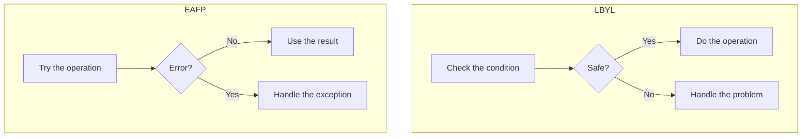

## 10. Pythonic Programming and EAFP vs LBYL

### What does "Pythonic" mean?
**Pythonic** code uses the features and style that Python programmers expect. It is clear, concise and idiomatic. Non-Pythonic code often works, but it looks like it was translated from another language.

Real-life comparison: **speaking a language naturally** versus translating word-for-word from another language. Both may be understood, but one sounds right.

```python
# not Pythonic
items = ["a", "b", "c"]
i = 0
while i < len(items):
    print(items[i])
    i = i + 1

# Pythonic
for item in items:
    print(item)
```

```python
# not Pythonic
result = []
for x in range(10):
    if x % 2 == 0:
        result.append(x * x)

# Pythonic
result = [x * x for x in range(10) if x % 2 == 0]
```

```python
# not Pythonic
if len(name) > 0:
    print(name)

# Pythonic
if name:
    print(name)
```

### Two ways to handle possible problems

There are two main styles for dealing with things that might go wrong, such as a missing key or a file that doesn't exist.

**LBYL: Look Before You Leap**
Check **first** whether the operation is safe, and only then do it.

```python
if "email" in user:
    print(user["email"])
else:
    print("No email")
```

**EAFP: Easier to Ask Forgiveness than Permission**
Try the operation, and **handle the error** if it fails.

```python
try:
    print(user["email"])
except KeyError:
    print("No email")
```

### How the two flows differ


### When to use which
- **EAFP** is preferred in Python in most cases. It is clear, and it avoids race conditions where a condition changes between the check and the action.
- **LBYL** is useful when the check is cheap and the error would be common or costly, or when a check reads more clearly.

### Race conditions: why EAFP is safer for files
Consider this LBYL check for a file:
```python
import os

if os.path.exists("data.txt"):
    with open("data.txt") as f:     # the file might be deleted just before this line!
        print(f.read())
```

EAFP avoids the gap:
```python
try:
    with open("data.txt") as f:
        print(f.read())
except FileNotFoundError:
    print("File not found")
```

### More Pythonic habits

**Use `in` for membership:**
```python
if status in ("active", "pending"):
    ...
```

**Use `enumerate()` instead of counters** (Section 8).

**Use unpacking:**
```python
name, age = ("Asha", 21)
first, *rest = [1, 2, 3, 4]
```

**Use `dict.get()` with a default:**
```python
city = user.get("city", "Unknown")
```

**Use `with` for resources** (Module 6).

**Use `is None` to check for `None`:**
```python
if value is None:
    ...
```

**Use `*` and `**` to unpack** (Module 5):
```python
def show(a, b, c):
    print(a, b, c)

values = [1, 2, 3]
show(*values)
```

**Use `join` to build strings** (Module 3):
```python
# not Pythonic: repeated string concatenation in a loop
result = ""
for word in ["a", "b", "c"]:
    result += word + ", "

# Pythonic
result = ", ".join(["a", "b", "c"])
```

### Real-time example: safely reading a config value
```python
# LBYL style
config = {"timeout": 30}
if "timeout" in config:
    timeout = config["timeout"]
else:
    timeout = 10

# Pythonic, one clear line
timeout = config.get("timeout", 10)
```

### Real-time example: converting user input, EAFP style
```python
def read_age():
    while True:
        try:
            return int(input("Enter your age: "))
        except ValueError:
            print("Please enter a whole number")

print("Your age is", read_age())
```

> **Trainer tip:** Ask students to write the same task in both styles, then compare which one reads more naturally. Usually EAFP wins for file and input handling, while LBYL wins for simple dictionary checks.

---