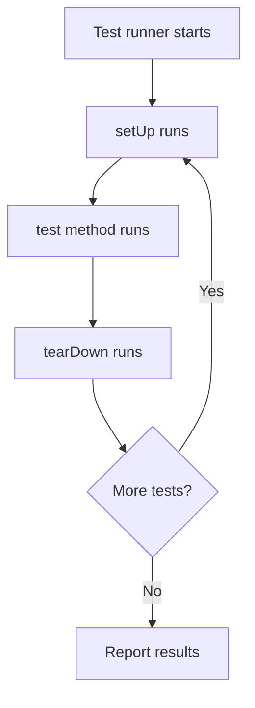

## 2. `unittest` Basics 

### What is `unittest`?
`unittest` is Python's **built-in testing framework**. You don't need to install anything. It is based on classes: you create a class that inherits from `unittest.TestCase`, and each method starting with `test_` is a test.

Real-life comparison: a **school exam**. The exam paper (the test class) has many questions (test methods). Each question has a clear expected answer.

### A first test file
Save this as `test_calculator.py`:
```python
import unittest

def add(a, b):
    return a + b

class TestAdd(unittest.TestCase):
    def test_add_positive_numbers(self):
        self.assertEqual(add(2, 3), 5)

    def test_add_negative_numbers(self):
        self.assertEqual(add(-2, -3), -5)

    def test_add_zero(self):
        self.assertEqual(add(7, 0), 7)

if __name__ == "__main__":
    unittest.main()
```

Run it:
```bash
python test_calculator.py
```
```
...
----------------------------------------------------------------------
Ran 3 tests in 0.001s

OK
```
Each `.` means one test passed.

### Common assertion methods
`unittest.TestCase` provides helpful assertion methods:
- `self.assertEqual(a, b)`: `a == b`
- `self.assertNotEqual(a, b)`: `a != b`
- `self.assertTrue(x)`: `x` is True
- `self.assertFalse(x)`: `x` is False
- `self.assertIn(item, container)`: `item` is in `container`
- `self.assertIsNone(x)`: `x` is None
- `self.assertIsInstance(obj, cls)`: `obj` is an instance of `cls`
- `self.assertAlmostEqual(a, b, places=2)`: useful for floats

```python
class TestHelpers(unittest.TestCase):
    def test_float_result(self):
        self.assertAlmostEqual(0.1 + 0.2, 0.3, places=5)

    def test_membership(self):
        self.assertIn("Python", ["Java", "Python", "C"])
```

### Setup and cleanup: `setUp` and `tearDown`
`setUp()` runs **before every test**, and `tearDown()` runs **after every test**. Use them to avoid repeating the same setup code.

```python
import unittest

class BankAccount:
    def __init__(self, balance):
        self.balance = balance

    def withdraw(self, amount):
        if amount > self.balance:
            raise ValueError("Insufficient funds")
        self.balance -= amount

class TestBankAccount(unittest.TestCase):
    def setUp(self):
        self.account = BankAccount(1000)       # fresh account for each test

    def test_withdraw_reduces_balance(self):
        self.account.withdraw(300)
        self.assertEqual(self.account.balance, 700)

    def test_withdraw_does_not_affect_next_test(self):
        self.assertEqual(self.account.balance, 1000)   # always starts at 1000
```

### Running tests with discovery
You can run all tests in a folder with:
```bash
python -m unittest discover
```
This finds every file named `test*.py` and runs its tests.

### Real-time example: testing a grade function
```python
import unittest

def grade(marks):
    if marks >= 90:
        return "A"
    elif marks >= 75:
        return "B"
    elif marks >= 40:
        return "C"
    return "F"

class TestGrade(unittest.TestCase):
    def test_top_grade(self):
        self.assertEqual(grade(95), "A")

    def test_middle_grade(self):
        self.assertEqual(grade(80), "B")

    def test_boundary_pass(self):
        self.assertEqual(grade(40), "C")       # edge case: exactly 40

    def test_fail(self):
        self.assertEqual(grade(39), "F")       # edge case: just below 40
```

### Test lifecycle diagram


---
