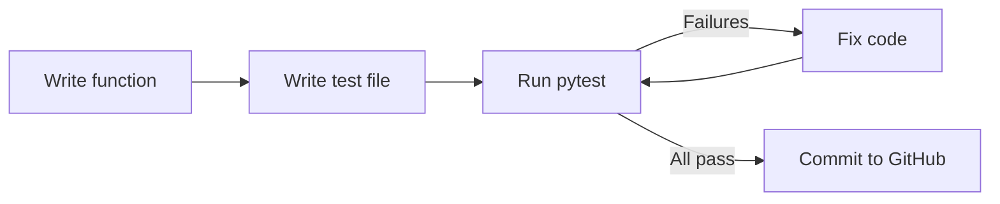

## 4. Introduction to `pytest`

### Why pytest?
`pytest` is the **most popular third-party testing tool** in Python. It uses plain `assert` statements, needs less boilerplate code than `unittest`, and gives very clear failure messages. You install it with pip (Module 9).

Real-life comparison: `unittest` is like filling in a **formal exam form**, while `pytest` is like writing a **simple checklist**. Both do the job, but the checklist is quicker to write.

```bash
python -m pip install pytest
```

### Your first pytest test
Save this as `test_math_utils.py`. Notice there is **no class** and **no import of a testing base class**.
```python
def add(a, b):
    return a + b

def test_add_positive():
    assert add(2, 3) == 5

def test_add_negative():
    assert add(-2, -3) == -5
```

Run it from the project folder:
```bash
python -m pytest
```
```
collected 2 items
test_math_utils.py ..        [100%]
2 passed
```

### Rules pytest follows
- Test files start with `test_` or end with `_test.py`.
- Test functions start with `test_`.
- Plain `assert` statements are used.

### Clear failure messages
When an assertion fails, pytest shows **both sides** of the comparison:
```python
def test_bad_example():
    assert add(2, 3) == 6
```
```
E       assert 5 == 6
```

### Testing exceptions with pytest
```python
import pytest

def test_divide_by_zero():
    with pytest.raises(ZeroDivisionError):
        divide(10, 0)
```

Checking part of the message:
```python
def test_divide_message():
    with pytest.raises(ZeroDivisionError, match="Cannot divide"):
        divide(10, 0)
```

### Fixtures: pytest's version of setUp
A **fixture** is a function that prepares data for tests. Tests ask for a fixture by naming it as a parameter.

```python
import pytest

class BankAccount:
    def __init__(self, balance):
        self.balance = balance

    def withdraw(self, amount):
        if amount > self.balance:
            raise ValueError("Insufficient funds")
        self.balance -= amount

@pytest.fixture
def account():
    return BankAccount(1000)

def test_withdraw(account):
    account.withdraw(300)
    assert account.balance == 700

def test_starts_full(account):
    assert account.balance == 1000
```

### Parametrized tests: many cases, one test
`@pytest.mark.parametrize` runs the same test with a list of inputs and expected outputs. This keeps test code short and covers many cases.

```python
import pytest

def grade(marks):
    if marks >= 90:
        return "A"
    elif marks >= 75:
        return "B"
    elif marks >= 40:
        return "C"
    return "F"

@pytest.mark.parametrize("marks, expected", [
    (95, "A"),
    (80, "B"),
    (40, "C"),
    (39, "F"),
])
def test_grade(marks, expected):
    assert grade(marks) == expected
```
pytest shows four separate results, one for each row.

### unittest vs pytest at a glance
- `unittest`: built in, class-based, uses `self.assertEqual`
- `pytest`: third-party, function-based, uses plain `assert`, fixtures and parametrize

Both are widely used. Many companies use pytest for new projects because it is easier to read.

### Testing workflow


### Real-time example: testing a shopping cart total
```python
import pytest

def cart_total(items):
    return sum(price * qty for price, qty in items)

@pytest.fixture
def sample_cart():
    return [(50, 2), (120, 1)]

def test_total_of_sample_cart(sample_cart):
    assert cart_total(sample_cart) == 220

@pytest.mark.parametrize("items, expected", [
    ([], 0),
    ([(10, 3)], 30),
    ([(5, 1), (5, 1)], 10),
])
def test_cart_total_cases(items, expected):
    assert cart_total(items) == expected
```

---