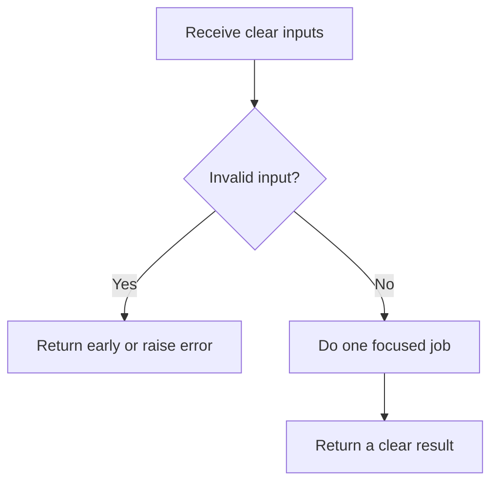

## 6. Readable Code and Function Design

### Why readability matters
Code is read far more often than it is written. Teammates, future-you and reviewers all spend time reading. Clear code saves time, reduces bugs and makes changes safer.

Real-life comparison: a **restaurant menu**. A good menu uses clear names and short descriptions, so you can order quickly. A confusing menu means mistakes and wasted time.

### Good names
Names should explain **what** something is or does.

```python
# hard to understand
d = 30
x = [p for p in ps if p.a > d]

# easy to understand
max_age = 30
adult_players = [p for p in players if p.age > max_age]
```

### Functions should do one thing
A good function has a **single, clear job**. If you need the word "and" to describe what it does, it probably should be two functions.

```python
# does too much
def process_order(order):
    total = sum(item["price"] for item in order["items"])
    save_to_database(order)
    send_email(order["email"], total)
    return total

# split into focused functions
def calculate_order_total(order):
    return sum(item["price"] for item in order["items"])

def process_order(order):
    total = calculate_order_total(order)
    save_to_database(order)
    send_email(order["email"], total)
    return total
```

### Keep functions short
A function that fits on one screen is easier to read. If it grows past about 20 to 30 lines, look for parts that can become their own function.

### Limit the number of parameters
Too many parameters make functions hard to call correctly. Group related values into a dictionary, a tuple or a dataclass (Module 8).

```python
# hard to use
def create_user(name, age, city, email, phone, is_admin):
    ...

# easier: group related values
from dataclasses import dataclass

@dataclass
class UserDetails:
    name: str
    age: int
    city: str
    email: str
    phone: str
    is_admin: bool = False

def create_user(details: UserDetails):
    ...
```

### Avoid deep nesting: return early
Deeply nested `if` statements are hard to follow. Return early when a condition fails.

```python
# deeply nested
def withdraw(account, amount):
    if account is not None:
        if amount > 0:
            if amount <= account.balance:
                account.balance -= amount
                return True
    return False

# flatter and clearer
def withdraw(account, amount):
    if account is None or amount <= 0:
        return False
    if amount > account.balance:
        return False
    account.balance -= amount
    return True
```

### Use meaningful return values, not hidden side effects
A function that returns a value is easier to test than one that only prints or changes global data.

```python
# hard to test: prints instead of returning
def show_total(items):
    print(sum(items))

# easy to test: returns the value
def total(items):
    return sum(items)
```

### Real-time example: cleaning up a messy report function
```python
# before
def report(s):
    r = ""
    for i in s:
        if i["m"] >= 40:
            if i["m"] >= 75:
                r += i["n"] + " A\n"
            else:
                r += i["n"] + " B\n"
    return r

# after
PASS_MARK = 40
DISTINCTION_MARK = 75

def grade_label(marks):
    if marks >= DISTINCTION_MARK:
        return "A"
    return "B"

def passing_students(students):
    return [s for s in students if s["marks"] >= PASS_MARK]

def build_report(students):
    lines = []
    for student in passing_students(students):
        lines.append(f"{student['name']} {grade_label(student['marks'])}")
    return "\n".join(lines)
```

### The flow of a clean function


---
