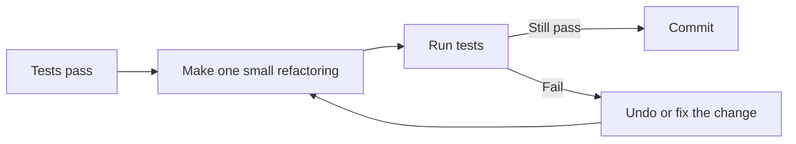

## 7. Refactoring and Avoiding Duplicate Code 

### What is refactoring?
**Refactoring** means improving the **structure** of existing code **without changing what it does**. The output stays the same, but the code becomes cleaner, shorter or easier to change.

Real-life comparison: **reorganising a messy kitchen**. You don't cook different food. You just put things in better places, so next time cooking is faster.

### The golden rule
Refactor only when your **tests pass before you start**, and make sure they still pass after each change. Tests are what prove you did not change the behaviour.



### The DRY principle: Don't Repeat Yourself
Duplicate code is a common source of bugs. If the same logic appears in two places, a fix in one place is easy to miss in the other.

Real-life example: a **school timetable** that is written separately for each class. If the lunch break changes, you must update every copy. Keeping one master timetable avoids the mistake.

### Example 1: removing duplicated code
```python
# duplicated
def area_of_square(side):
    return side * side

def area_of_square_2(side_length):
    return side_length * side_length

# one function, used everywhere
def square_area(side):
    return side * side
```

### Example 2: extracting a repeated calculation
```python
# before: GST calculated in three places
price_a = 100
total_a = price_a + price_a * 0.18

price_b = 250
total_b = price_b + price_b * 0.18

price_c = 80
total_c = price_c + price_c * 0.18

# after: one function
def with_gst(price, rate=0.18):
    return price + price * rate

total_a = with_gst(100)
total_b = with_gst(250)
total_c = with_gst(80)
```

### Example 3: using a loop instead of copy-paste
```python
# before
print("Week 1:", sales[0])
print("Week 2:", sales[1])
print("Week 3:", sales[2])
print("Week 4:", sales[3])

# after
for week, amount in enumerate(sales, start=1):
    print(f"Week {week}:", amount)
```

### Example 4: moving a magic number into a named constant
```python
# before: what does 0.18 mean?
price = price * 1.18

# after: the name explains it
GST_RATE = 0.18
price = price * (1 + GST_RATE)
```

### Refactoring checklist
- Are the same lines written more than once? Make a function.
- Is there a value that appears without explanation? Make a named constant.
- Is one function doing several jobs? Split it.
- Is the code nested deeply? Return early.
- Is a name unclear? Rename it.

### Real-time example: a before and after refactoring session
```python
# before
def check(users):
    result = []
    for u in users:
        if u["active"] == True:
            if u["email"] != "":
                if "@" in u["email"]:
                    result.append(u["email"])
    return result

# after
def is_valid_email(email):
    return bool(email) and "@" in email

def active_valid_emails(users):
    return [user["email"] for user in users
            if user["active"] and is_valid_email(user["email"])]
```

> **Trainer note:** Students often think refactoring means rewriting. It doesn't. Refactor in **small steps**, and check the tests after every step.

---
