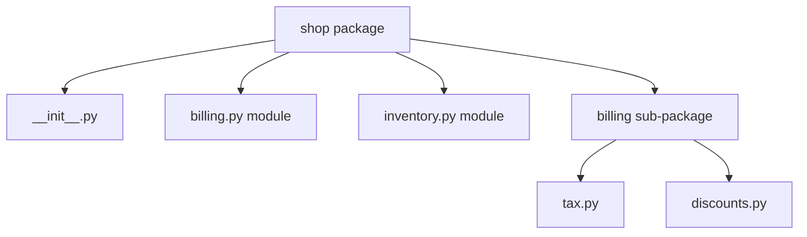

# Module 9: Packages, Virtual Environments and Project Structure

### Why does this module matter?
A single file with 20 lines is easy to manage. A real project has hundreds of files, uses libraries installed from the internet, and is shared with teammates on GitHub. This module teaches you how to **organise code into packages**, **keep project dependencies separate** with virtual environments, and **set up a project** that others can run without trouble.

Real-life comparison: a **well-organised house**. Rooms (packages) hold related things, a shopping list (requirements file) records what to buy, a separate storage box (virtual environment) keeps one house's supplies from mixing with another's, and a "do not throw away" list (`.gitignore`) protects the important items.

---

## 1. Packages and Package Structure

### What is a package?
A **package** is a **folder that contains Python modules** (`.py` files), grouped together because they belong to the same topic. A package lets you organise a large project into clear sections.

Real-life example: a **supermarket**. Items are arranged into sections like "Dairy", "Vegetables" and "Bakery". Each section is like a package, and each item on a shelf is like a module.

### A simple package layout
```
shop/
├── __init__.py
├── billing.py
└── inventory.py
```

- `shop/` is the **package** (a folder).
- `billing.py` and `inventory.py` are **modules** inside it.
- `__init__.py` marks the folder as a package (explained in Section 2).

### Using a package
```python
from shop import billing
from shop.inventory import check_stock

print(billing.calculate_total(250, 2))
print(check_stock("Milk"))
```
The dot `.` means "go inside this package". `shop.inventory` means "the `inventory` module inside the `shop` package".

### Nested (sub-)packages
Packages can contain other packages, which lets you keep growing your structure.

```
shop/
├── __init__.py
├── billing/
│   ├── __init__.py
│   ├── tax.py
│   └── discounts.py
└── inventory/
    ├── __init__.py
    └── stock.py
```

```python
from shop.billing.tax import add_gst
from shop.inventory.stock import check_stock
```

### How Python sees the structure


### Rules to remember
- Each folder that acts as a package should have an `__init__.py` file (see Section 2).
- Use lowercase names with underscores for packages and modules, for example `user_data` or `payment_utils`.
- Avoid names that clash with built-in or standard library modules, such as `random.py` or `json.py`.

### Real-time example: a school management app
```
school/
├── __init__.py
├── students/
│   ├── __init__.py
│   └── records.py
├── teachers/
│   ├── __init__.py
│   └── salary.py
└── reports/
    ├── __init__.py
    └── marksheet.py
```
Each team member can work on one package without disturbing the others, and anyone reading the project can guess where things are.

---