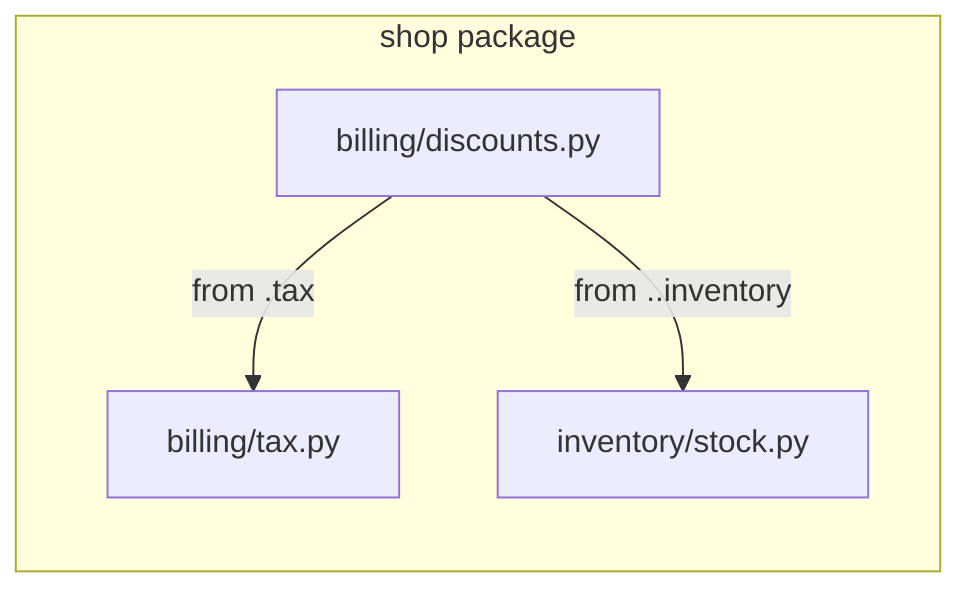

## 3. Absolute and Relative Imports

### Absolute imports: the full address
An **absolute import** starts from the top-level package and gives the full path.

```python
from shop.billing.tax import add_gst
```
This always works, no matter where the importing file is.

Real-life example: giving someone the **full postal address**, including country, state, city, street and house number. It works from anywhere.

### Relative imports: the address from where you stand
A **relative import** uses dots to describe a location **relative to the current file**.

- `.` means "this package" (the same folder)
- `..` means "the parent package" (one folder up)

```python
# shop/billing/discounts.py

from .tax import add_gst          # tax.py is in the same folder
from ..inventory.stock import check_stock   # go up one level, then into inventory
```

Real-life example: telling a friend in the same building "the lift is **next to you**" (relative) instead of giving the full street address (absolute).

### Relative imports only work inside a package


> **Important rule:** Relative imports only work when the file is imported **as part of a package**. Running it directly (`python discounts.py`) causes an error such as `ImportError: attempted relative import with no known parent package`. Run the program from the top-level folder, or use `python -m shop.billing.discounts`.

### Choosing between them
- Use **absolute imports** by default. They are clearer and less error-prone.
- Use **relative imports** inside a package when you want the package to be easy to rename or move.

### Real-time example: moving a whole project
Suppose you rename the folder `shop` to `store`. Absolute imports like `from shop.billing import ...` break in every file. Relative imports like `from .billing import ...` inside the package keep working, because they never mention the package name.

---
