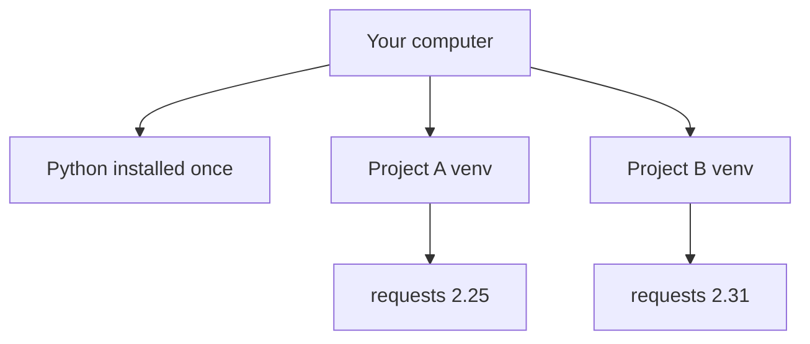
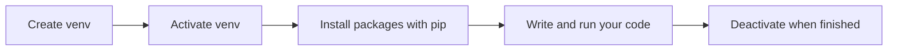

## 4. Virtual Environments and `venv` 

### The problem
Two projects may need **different versions** of the same library:
- Project A needs `requests` version 2.25
- Project B needs `requests` version 2.31

If you install everything into one shared Python, the second install overwrites the first, and one project breaks.

Real-life example: two families sharing one fridge. Each family needs its own shelf, or the milk from one family gets mixed with the other's.

### The solution: a virtual environment
A **virtual environment** is a separate, isolated folder that holds its own Python and its own libraries. Each project gets its own environment.



### Creating a virtual environment with `venv`
`venv` is built into Python 3, so you don't need to install anything extra.

```bash
python -m venv venv
```
- The first `venv` is the module name.
- The second `venv` is the **name of the folder** that will hold the environment. Many people use `venv` or `.venv`.

### Activating it
You must **activate** the environment so that your terminal uses its Python and libraries.

Windows (Command Prompt):
```bat
venv\Scripts\activate
```

Windows (PowerShell):
```powershell
venv\Scripts\Activate.ps1
```

Mac/Linux:
```bash
source venv/bin/activate
```

When it is active, your terminal prompt usually shows the environment name in brackets:
```
(venv) C:\projects\shop>
```

### Checking which Python you are using
```bash
python --version
where python        # Windows
which python        # Mac/Linux
```
The path should point inside your `venv` folder.

### Leaving the environment
```bash
deactivate
```

### The full workflow


### Real-time example: a quick setup for a new project
```bash
mkdir shop-app
cd shop-app
python -m venv venv
venv\Scripts\activate          # Windows (use source venv/bin/activate on Mac/Linux)
python -m pip install requests
python -c "import requests; print(requests.__version__)"
```

> **Trainer tip:** Students often install packages before activating. Ask them to check the prompt for `(venv)` before every `pip install`. Tell them that `python -m pip` is a safe way to make sure pip belongs to the active Python.

### Never upload the environment to GitHub
The `venv` folder is large and specific to one computer. It should be listed in `.gitignore` (Section 9). Teammates create their own environment from `requirements.txt` (Section 7).

---
