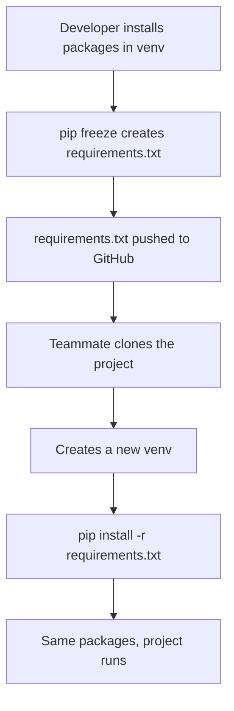

## 6. `requirements.txt` and Dependencies

### What is a dependency?
A **dependency** is an external package that your project needs in order to run. For example, a web app might depend on `flask` and `requests`.

### What is requirements.txt?
`requirements.txt` is a plain-text file that lists all the dependencies of a project, with their versions. Anyone who gets your project can install the exact same packages.

Real-life example: a **recipe card** that lists every ingredient and its quantity. Anyone can cook the same dish using the card.

### Creating the file
You can write it by hand:
```text
requests==2.31.0
pandas>=2.0
numpy
```

Or generate it from your active environment:
```bash
python -m pip freeze > requirements.txt
```
`pip freeze` lists every installed package with its exact version. Use it carefully, because it also includes packages your project may not need directly.

### Version specifiers
- `==` exact version: `requests==2.31.0`
- `>=` at least this version: `pandas>=2.0`
- `~=` compatible release: `numpy~=1.26` (1.26 or later, but below 2.0)
- no version: installs the latest version

### Installing from the file on another computer
```bash
python -m venv venv
venv\Scripts\activate
python -m pip install -r requirements.txt
```
The teammate now has the same packages as you.

### The workflow


### Real-time example: a small API project
```text
# requirements.txt
flask==3.0.0
requests==2.31.0
python-dotenv==1.0.0
```
A new team member sets up the project in three commands, and the app runs exactly as it does for you.

### Keep it clean
- Include only the packages your project **directly** needs, unless you deliberately pin everything.
- Commit `requirements.txt` to GitHub. Never commit the `venv` folder.

---