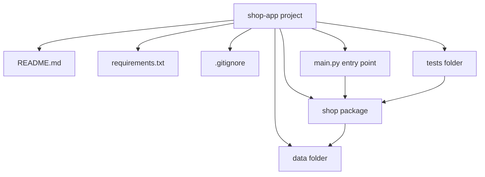

## 8. Project Structure

### Why structure matters
A messy project with everything in one folder is hard to understand, test and share. A clear structure tells a new developer where to look, and tools like testing frameworks and packaging systems expect certain layouts.

Real-life comparison: a **library**. Books are organised into sections, shelves and catalogue numbers. You can find any book quickly, even in a huge library.

### A typical beginner project layout
```
shop-app/
├── README.md
├── requirements.txt
├── .gitignore
├── main.py
├── shop/
│   ├── __init__.py
│   ├── billing.py
│   └── inventory.py
├── tests/
│   ├── __init__.py
│   └── test_billing.py
└── data/
    └── products.csv
```

### What each part is for
- **README.md**: explains what the project does, how to install it and how to run it
- **requirements.txt**: lists the packages the project needs
- **.gitignore**: tells Git which files to ignore (Section 9)
- **main.py**: the entry point, the file you run to start the program
- **shop/**: the main package with the core logic
- **tests/**: automated tests (Module 10)
- **data/**: input files and sample data

### How the parts connect


### The entry point: `main.py`
Put the start of the program in `main.py`, and keep the logic in the package. Use the `if __name__ == "__main__":` guard from Module 5.

```python
# main.py
from shop.billing import calculate_total

def main():
    total = calculate_total(price=250, quantity=2)
    print(f"Total bill: Rs.{total}")

if __name__ == "__main__":
    main()
```

```python
# shop/billing.py
def calculate_total(price, quantity, gst=0.18):
    return round(price * quantity * (1 + gst), 2)
```

Run it from the project root:
```bash
python main.py
```

### Keep logic out of the root folder
Avoid writing long functions directly in `main.py`. Put reusable code inside the package, so it can be tested and imported from anywhere.

### Real-time example: a new project from scratch
```bash
mkdir shop-app
cd shop-app
python -m venv venv
venv\Scripts\activate
mkdir shop tests data
type nul > shop\__init__.py
type nul > tests\__init__.py
type nul > main.py
type nul > README.md
type nul > requirements.txt
type nul > .gitignore
```
On Mac/Linux, replace `type nul >` with `touch` and the activation line with `source venv/bin/activate`.

---