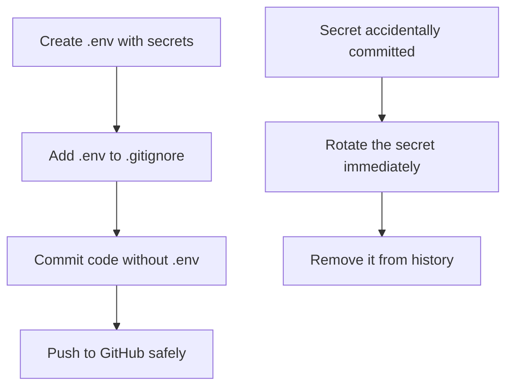

## 9. `.gitignore` and Basic Project Hygiene 

### What is `.gitignore`?
`.gitignore` is a plain-text file that tells **Git** (the version control system used with GitHub) which files and folders **not to track or upload**.

Real-life comparison: a **"do not disturb" sign** on a door. Anyone looking through the door knows which rooms to leave alone.

### Why ignore files?
Some files should never be shared:
- the `venv` folder (large, and specific to your computer)
- secret files like `.env` (passwords and API keys)
- temporary files and caches (`__pycache__`)
- editor settings and personal data

### A starter `.gitignore` for Python
```gitignore
# Virtual environments
venv/
.venv/

# Python cache
__pycache__/
*.pyc

# Secrets
.env

# Test and coverage output
.pytest_cache/
.coverage
htmlcov/

# Editor and OS files
.vscode/
.idea/
.DS_Store
Thumbs.db

# Build output
build/
dist/
*.egg-info/

# Local data and logs
*.log
```

### How the patterns work
- `venv/` ignores the whole folder named `venv`
- `*.pyc` ignores every file ending with `.pyc`
- `.env` ignores one specific file
- `*.log` ignores every log file

### Checking what Git ignores
```bash
git status          # shows tracked and untracked files
git check-ignore -v venv/
```

### Important: `.gitignore` does not remove files already tracked
If a file was committed earlier, adding it to `.gitignore` does nothing until you remove it from Git's tracking:
```bash
git rm --cached .env
```
This removes it from Git but keeps the file on your computer.

### If a secret was pushed by mistake
Removing the file is not enough. The secret is still in the history. **Change the password or API key immediately**, and then clean the history.



### Basic project hygiene checklist
- Keep a clear `README.md` with install and run steps.
- Commit `requirements.txt`, and never commit `venv`.
- Never write passwords or API keys in code. Use environment variables (Module 6).
- Keep your `.gitignore` updated as the project grows.
- Commit small, clear changes with meaningful messages.

### Real-time example: a repository that is safe to share
```
shop-app/           ← committed to GitHub
├── .gitignore      ← committed
├── README.md       ← committed
├── requirements.txt← committed
├── main.py         ← committed
├── shop/           ← committed
├── .env            ← NOT committed (ignored)
└── venv/           ← NOT committed (ignored)
```
A new developer clones the repository, creates their own `.env`, creates their own `venv`, and runs `pip install -r requirements.txt`. The project runs without any secrets being shared.

---
