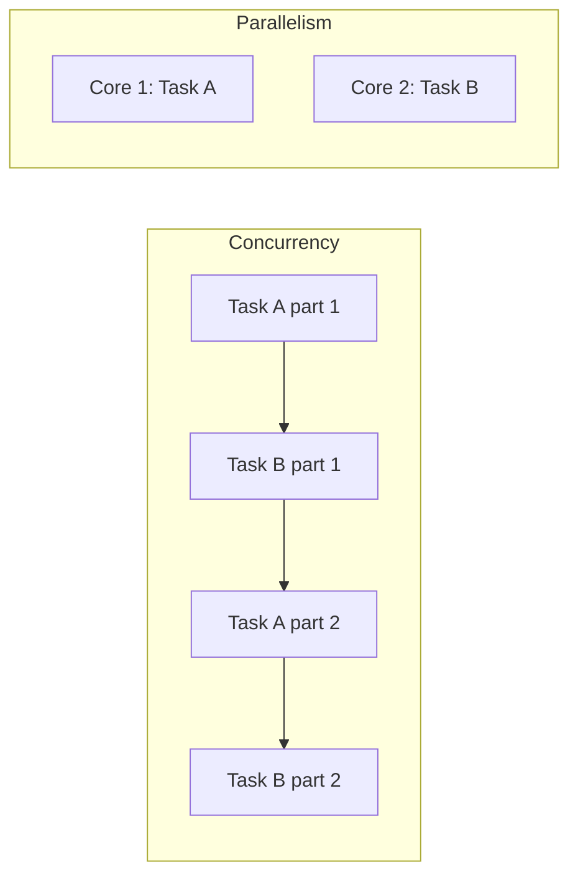

# Module 11: Concurrency

### Why does this module matter?
Real programs often wait. A web app waits for a database, a downloader waits for the internet, and a data script waits for a large file. If the program does one thing at a time, the CPU sits idle while it waits. **Concurrency** lets a program make progress on several things at once, so it finishes faster and uses resources better.

Real-life comparison: a **restaurant kitchen**. One cook who makes each dish from start to finish serves very few customers. A kitchen where one cook starts the rice, another chops vegetables, and a third prepares the sauce while the rice cooks serves many more. The same idea applies to programs.

---

## 1. Concurrency vs Parallelism

### Concurrency: managing many tasks at once
**Concurrency** means a program has **several tasks in progress** at the same time. The tasks may take turns on a single CPU core, switching whenever one of them is waiting.

Real-life example: a **single cashier** at a shop who serves one customer, then, while the card machine processes a payment, starts helping the next customer. Only one person is at the counter at a time, but many customers are being served in an overlapping way.

### Parallelism: doing many tasks at the same moment
**Parallelism** means several tasks are **actually running at the same instant**, on different CPU cores.

Real-life example: **several cashiers** serving customers at the same time, each at their own counter.

### The difference in one picture


| Idea | What it means | Analogy |
|---|---|---|
| Concurrency | Many tasks in progress, taking turns | One cashier, many customers |
| Parallelism | Many tasks running at the same instant | Many cashiers, many customers |

> **Note for the trainer:** Concurrency is about **structure** (dealing with many things), and parallelism is about **execution** (doing many things simultaneously). A program can be concurrent without being parallel, and a single-core machine can only do concurrency.

### Checking your CPU cores
```python
import os
print("CPU cores:", os.cpu_count())
```

### Why this matters in Python
Because of the **Global Interpreter Lock (GIL)** in standard CPython, only one thread runs Python bytecode at a time. This means threads give you concurrency, but **not** true parallelism for CPU-heavy work. To use several cores for heavy calculations, Python uses **multiprocessing** (Section 6).

---
