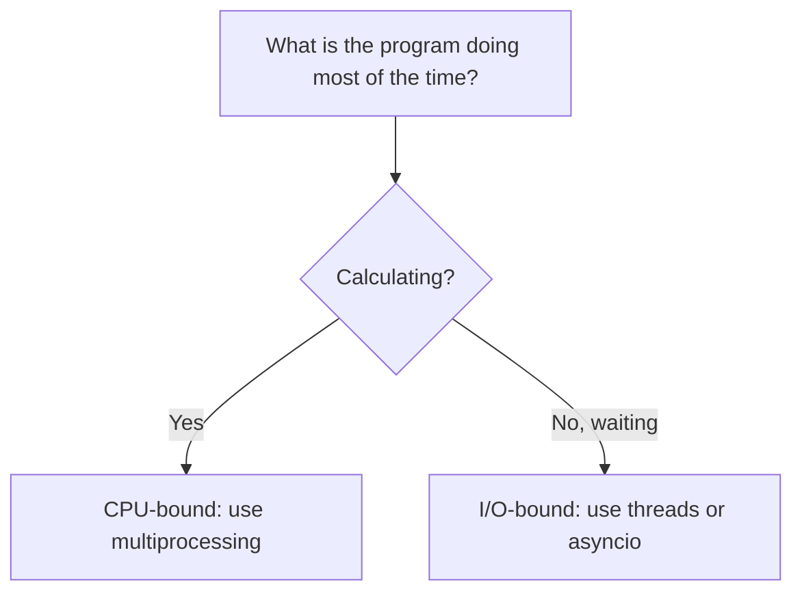

## 2. CPU-bound vs I/O-bound Tasks 


Before choosing a tool, first identify **what the program is waiting for**.

### CPU-bound tasks
A **CPU-bound** task spends its time **calculating**. The processor is busy the whole time.

Examples: calculating prime numbers, image processing, training a machine learning model, compressing a large file.

```python
def count_primes(limit):
    count = 0
    for n in range(2, limit):
        if all(n % d for d in range(2, int(n ** 0.5) + 1)):
            count += 1
    return count

print(count_primes(200_000))
```

### I/O-bound tasks
An **I/O-bound** task spends most of its time **waiting** for input or output: a network response, a disk read, a database query, or a user typing.

Examples: downloading web pages, calling an API, reading a large file, sending emails.

```python
import time

def download_page(name):
    print(f"Requesting {name}")
    time.sleep(2)            # simulates waiting for the network
    print(f"Got {name}")

download_page("page 1")
```

### Rule of thumb


Real-life comparison:
- **CPU-bound** is like a chef **cutting vegetables** nonstop. Adding more chefs (cores) helps.
- **I/O-bound** is like a chef **waiting for the oven timer**. The chef can prepare other dishes while the oven works.

### Quick check questions for students
- A program that resizes 500 photos: CPU-bound or I/O-bound? (Mostly CPU-bound, because it calculates.)
- A program that checks the status of 100 websites: CPU-bound or I/O-bound? (I/O-bound, because it waits for responses.)

---
