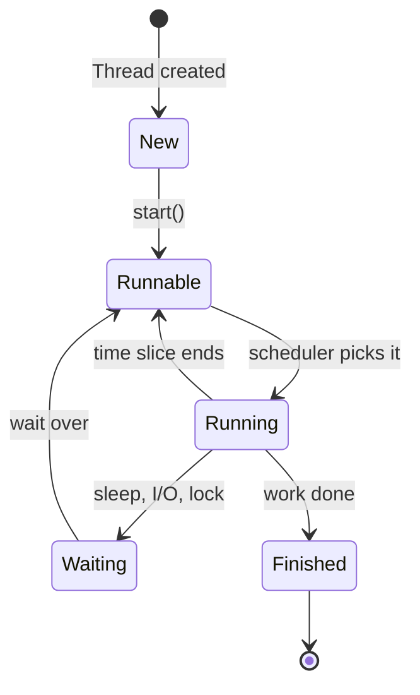

## 3. Threads and Thread Management

### What is a thread?
A **thread** is a separate path of execution **inside one program**. All threads share the same memory, so they can access the same variables.

Real-life example: a **single office** with several workers. They share the same filing cabinet (shared memory), and each one works on their own task.

### Creating and starting threads
```python
import threading
import time

def worker(name):
    print(f"{name} started")
    time.sleep(1)
    print(f"{name} finished")

t1 = threading.Thread(target=worker, args=("Task A",))
t2 = threading.Thread(target=worker, args=("Task B",))

t1.start()
t2.start()

t1.join()        # wait for t1 to finish
t2.join()        # wait for t2 to finish
print("All tasks done")
```
```
Task A started
Task B started
Task A finished
Task B finished
All tasks done
```
Both tasks ran at the same time, so the total time is about 1 second, not 2.

### Key methods
- `start()`: begins the thread's work
- `join()`: makes the main program **wait** until that thread finishes
- `is_alive()`: returns True while the thread is still running

### Why `join()` matters
Without `join()`, the main program may move on before the threads finish, and results may be missing.

### Passing arguments
Use `args=(...)` for positional arguments and `kwargs={...}` for keyword arguments.
```python
t = threading.Thread(target=worker, kwargs={"name": "Task C"})
```

### Daemon threads
A **daemon thread** runs in the background and is stopped automatically when the main program ends.
```python
t = threading.Thread(target=worker, args=("Background",), daemon=True)
```
Use daemon threads for background helpers like logging or heartbeat checks. Do not use them for work that must finish.

### Thread pools: the better way to manage many threads
Creating a thread for each task becomes messy. `ThreadPoolExecutor` manages a fixed number of worker threads for you.

```python
from concurrent.futures import ThreadPoolExecutor
import time

def fetch(url):
    time.sleep(1)                  # simulates a network call
    return f"Data from {url}"

urls = ["site1.com", "site2.com", "site3.com", "site4.com"]

with ThreadPoolExecutor(max_workers=4) as executor:
    results = list(executor.map(fetch, urls))

for r in results:
    print(r)
```
Four downloads of one second each finish in about one second in total.

### Getting return values from threads
A plain `Thread` does not return a value. Use `executor.submit()` to get a `Future`.
```python
from concurrent.futures import ThreadPoolExecutor

def square(n):
    return n * n

with ThreadPoolExecutor(max_workers=3) as executor:
    future = executor.submit(square, 7)
    print(future.result())      # 49
```

### Thread lifecycle


### Real-time example: checking several websites at once
```python
import threading
import time

sites = ["google.com", "github.com", "python.org"]

def check_site(site):
    time.sleep(1)               # pretend to make a request
    print(f"{site} is up")

start = time.perf_counter()

threads = [threading.Thread(target=check_site, args=(s,)) for s in sites]
for t in threads:
    t.start()
for t in threads:
    t.join()

print(f"Checked {len(sites)} sites in {time.perf_counter() - start:.1f} seconds")
```
Checking one after another would take about 3 seconds. With threads, it takes about 1 second.

---
