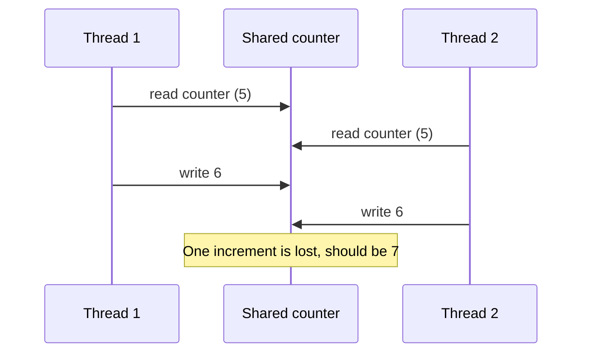

## 4. Race Conditions and Shared Data

### The danger of shared data
Threads share memory. If two threads change the **same variable** at the same time, the result can be **wrong**. This is called a **race condition**.

Real-life example: two people sharing **one bank account**. Both check the balance at the same time, see 1000, and each withdraws 800. The account ends up with -600, because both withdrawals happened before either updated the balance.

### A simple race condition
```python
import threading

counter = 0

def add_many():
    global counter
    for _ in range(1_000_000):
        counter += 1           # NOT safe with threads

threads = [threading.Thread(target=add_many) for _ in range(2)]
for t in threads:
    t.start()
for t in threads:
    t.join()

print("Expected 2000000, got", counter)
```
The output is often **less than 2,000,000**, and it changes from run to run. The reason: `counter += 1` is really three steps (read the value, add one, write it back). Two threads can read the same value, both add one, and write back the same result, so one increment is lost.

### Why `counter += 1` is not one step


### Real-time example: a shared ticket counter
```python
import threading

tickets_left = 10
sold = []

def sell_ticket(buyer):
    global tickets_left
    if tickets_left > 0:          # two threads can pass this check together
        tickets_left -= 1
        sold.append(buyer)

threads = [threading.Thread(target=sell_ticket, args=(f"Buyer {i}",)) for i in range(15)]
for t in threads:
    t.start()
for t in threads:
    t.join()

print("Tickets sold:", len(sold))
print("Tickets left:", tickets_left)
```
With unlucky timing, more than 10 tickets can be sold. The check and the update must be protected together, which is what locks do.

### Immutable data is safer
Data that cannot change (tuples, strings, frozen dataclasses from Module 8) is safe to share between threads, because no thread can change it.

### Thread-safe structures
Some structures, like `queue.Queue`, are designed to be used by several threads at once.
```python
import queue

q = queue.Queue()
q.put("job 1")
q.put("job 2")
print(q.get())     # job 1
```

---