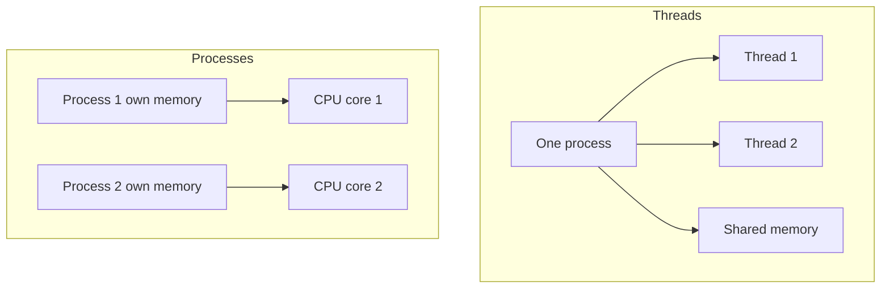

## 6. Multiprocessing 

### Why multiprocessing?
Because of the GIL, threads cannot run Python code on several cores at once. For **CPU-bound** work, **processes** solve this. Each process is a separate program with its own Python interpreter and its own memory, so each one can use its own CPU core.

Real-life comparison: **hiring separate chefs in separate kitchens** instead of asking one kitchen to cook faster. Each kitchen has its own stove and its own ingredients.

### Threads vs processes


### Creating a process
```python
import multiprocessing

def say_hello(name):
    print(f"Hello from {name}")

if __name__ == "__main__":
    p = multiprocessing.Process(target=say_hello, args=("process 1",))
    p.start()
    p.join()
```

> **Important:** Always put process creation inside `if __name__ == "__main__":` (Module 5). Without it, some systems (especially Windows) start new processes recursively and crash.

### Speeding up CPU-bound work with a pool
A `Pool` splits a list of jobs across several processes.

```python
import multiprocessing
import time

def count_primes(limit):
    count = 0
    for n in range(2, limit):
        if all(n % d for d in range(2, int(n ** 0.5) + 1)):
            count += 1
    return count

if __name__ == "__main__":
    limits = [100_000, 100_000, 100_000, 100_000]

    start = time.perf_counter()
    with multiprocessing.Pool(processes=4) as pool:
        results = pool.map(count_primes, limits)
    print("Results:", results)
    print(f"Time with 4 processes: {time.perf_counter() - start:.2f}s")
```
On a machine with four or more cores, this runs noticeably faster than doing the four calls one after another.

### Getting the number of cores
```python
import multiprocessing
print(multiprocessing.cpu_count())
```

### Sharing data between processes
Processes do not share memory by default, so use a `Queue` to pass results back.

```python
import multiprocessing

def worker(q, value):
    q.put(value * value)

if __name__ == "__main__":
    q = multiprocessing.Queue()
    procs = [multiprocessing.Process(target=worker, args=(q, n)) for n in [2, 3, 4]]

    for p in procs:
        p.start()
    for p in procs:
        p.join()

    results = [q.get() for _ in procs]
    print(sorted(results))     # [4, 9, 16]
```

### When to use multiprocessing
- **Yes**: heavy calculations, image or video processing, data crunching, machine learning preprocessing.
- **No**: tasks that mostly wait for the network or disk. Threads or asyncio are lighter and simpler for those.

### Real-time example: resizing many images
```python
import multiprocessing

def resize_image(filename):
    # imagine heavy image processing here
    return f"{filename} resized"

if __name__ == "__main__":
    images = ["a.jpg", "b.jpg", "c.jpg", "d.jpg"]
    with multiprocessing.Pool() as pool:
        for result in pool.map(resize_image, images):
            print(result)
```

---