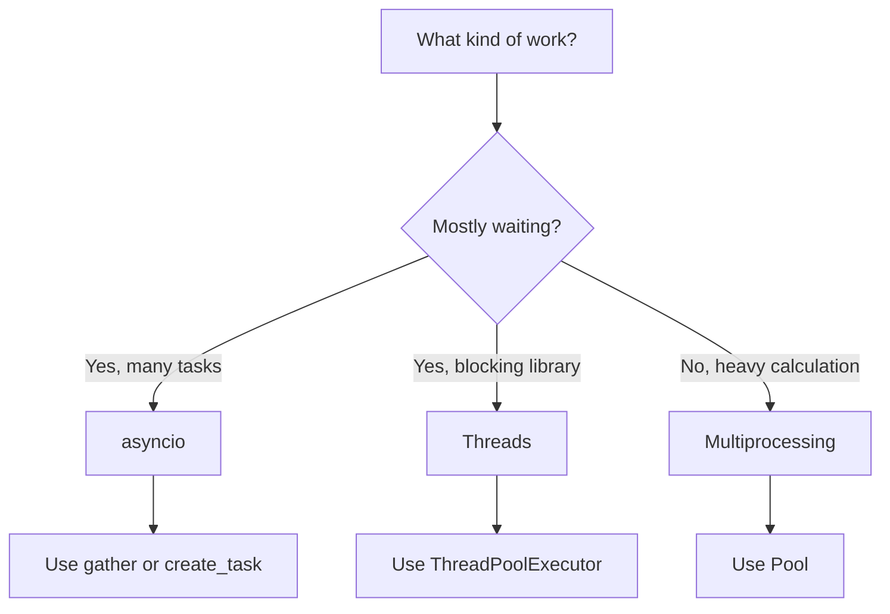

## 8. `asyncio` and Basic Asynchronous Tasks

### What is asyncio?
`asyncio` is Python's standard library for writing asynchronous code. It provides the **event loop** that runs coroutines and the tools to run many of them together.

### `asyncio.gather()`: run many tasks together
`gather()` starts several coroutines at the same time and waits until all of them finish.

```python
import asyncio

async def prepare(dish, seconds):
    print(f"Started {dish}")
    await asyncio.sleep(seconds)
    print(f"Ready: {dish}")
    return dish

async def main():
    results = await asyncio.gather(
        prepare("Dosa", 2),
        prepare("Coffee", 1),
        prepare("Idli", 3),
    )
    print("All ready:", results)

asyncio.run(main())
```
```
Started Dosa
Started Coffee
Started Idli
Ready: Coffee
Ready: Dosa
Ready: Idli
All ready: ['Dosa', 'Coffee', 'Idli']
```
The total time is about **3 seconds** (the longest dish), not 6.

Note that `gather()` returns results in the **order you passed the tasks**, even if they finish in a different order.

### `asyncio.create_task()`: start a task and keep working
```python
import asyncio

async def download(name, seconds):
    await asyncio.sleep(seconds)
    return f"{name} downloaded"

async def main():
    task1 = asyncio.create_task(download("File 1", 2))
    task2 = asyncio.create_task(download("File 2", 1))

    print("Both downloads started, doing other work...")

    print(await task1)
    print(await task2)

asyncio.run(main())
```

### `asyncio.wait_for()`: set a time limit
```python
import asyncio

async def slow_server():
    await asyncio.sleep(5)
    return "response"

async def main():
    try:
        result = await asyncio.wait_for(slow_server(), timeout=2)
        print(result)
    except asyncio.TimeoutError:
        print("Server took too long, giving up")

asyncio.run(main())
```

### Using `async for` and `async with` (overview)
These are the asynchronous versions of `for` and `with`. Many libraries use them, such as ones for web requests and databases. Students should recognise them, even if they don't write them yet.

### Asyncio vs threads: which to choose?
- **asyncio**: many I/O tasks (thousands of web requests), where tasks cooperate by awaiting.
- **Threads**: I/O tasks that use blocking libraries that cannot be awaited.
- **Processes**: CPU-heavy calculations that need several cores.

### Real-time example: checking many websites with asyncio
```python
import asyncio

async def check_site(site):
    await asyncio.sleep(1)        # pretend to wait for the response
    return f"{site}: up"

async def main():
    sites = ["google.com", "github.com", "python.org", "wikipedia.org"]
    results = await asyncio.gather(*(check_site(s) for s in sites))
    for line in results:
        print(line)

asyncio.run(main())
```
Four sites are checked in about 1 second total, using only one thread.

### Real-time example: an async order tracker
```python
import asyncio
import random

async def track_order(order_id):
    delay = random.uniform(0.5, 2.0)
    await asyncio.sleep(delay)
    return order_id, f"Delivered in {delay:.1f}s"

async def main():
    orders = [101, 102, 103]
    results = await asyncio.gather(*(track_order(o) for o in orders))
    for order_id, status in results:
        print(f"Order {order_id}: {status}")

asyncio.run(main())
```

### Choosing the right tool



---
